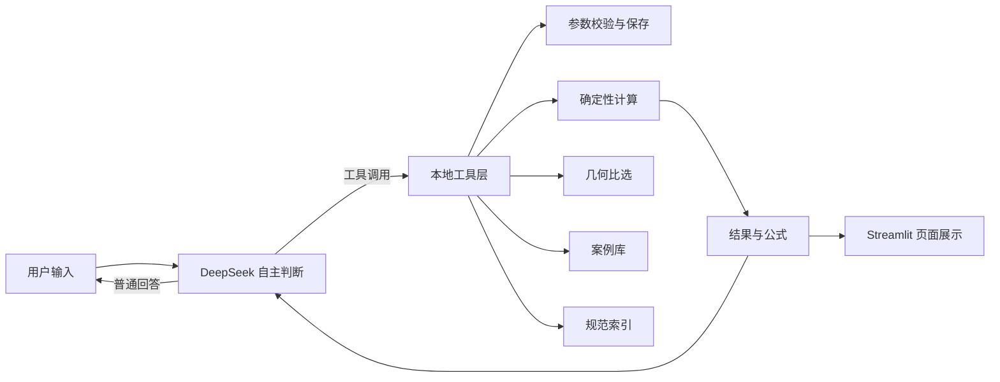

# 基于 DeepSeek 的重力式挡土墙初步设计智能体

[](https://www.python.org/)
[](https://streamlit.io/)
[](LICENSE)

一个对话式的重力式挡土墙**教学初算**原型。聊天内容由 DeepSeek 生成，模型可以自行决定是否调用参数保存、确定性计算、几何比选、案例库和规范索引工具。所有工程数值由本地算法计算，网页同步展示计算公式、规范覆盖状态和工具调用记录，便于逐项复核。

> [!WARNING]
> 本项目仅用于教学和方法演示，**不是施工图设计**，不能替代注册工程师依据完整标准与勘察资料完成的正式设计。

## 功能特点

- **DeepSeek 自主工具调用**：不把对话预先分配到固定意图；模型可以自然追问条件、直接解释概念，或调用本地工具。
- **确定性工程计算**：主动土压力、抗滑移、抗倾覆、基底合力位置和基底压力均由 Python 算法计算，模型不负责编造数值。
- **结果可追溯**：展示逐项公式与代入值、所选规范的覆盖状态、每轮实际工具调用记录，并支持下载 JSON / Markdown。
- **几何比选**：在 0.1 m 网格上搜索墙底宽和/或墙顶宽，可锁定某一尺寸，并列出侧重不同目标的候选方案。
- **教学案例库**：内置三组教学案例，也可把当前参数和结果保存到本地 SQLite 数据库。
- **规范索引**：可勾选 GB 50330-2013、GB 55003-2021、GB 50007-2011，明确区分“已做教学对照”和“尚未验算”。
- **本地密钥隔离**：支持环境变量或本地配置文件，密钥与本地数据库不会进入 Git 仓库。

## 工作流程



## 快速开始

### 1. 环境要求

- Python 3.10 及以上
- 一个可用的 [DeepSeek](https://platform.deepseek.com/) API Key

### 2. 安装依赖

克隆或下载本仓库后，进入项目目录：

```bash
python -m venv .venv
```

激活虚拟环境：

```powershell
# Windows PowerShell
.venv\Scripts\Activate.ps1

# 如果 PowerShell 禁止运行脚本，可只对当前终端放开：
Set-ExecutionPolicy -Scope Process -ExecutionPolicy Bypass
```

```bash
# macOS / Linux
source .venv/bin/activate
```

安装依赖：

```bash
python -m pip install --upgrade pip
python -m pip install -r requirements.txt
```

### 3. 配置 DeepSeek API Key

**方式一：环境变量（推荐，优先级更高）**

```powershell
# Windows PowerShell（仅当前终端有效）
$env:DEEPSEEK_API_KEY = "sk-你的密钥"
```

```bash
# macOS / Linux
export DEEPSEEK_API_KEY="sk-你的密钥"
```

如需在 Windows 上永久设置，可执行 `setx DEEPSEEK_API_KEY "sk-你的密钥"`，然后**新开一个终端**再启动。

**方式二：本地配置文件**

```powershell
# Windows
Copy-Item local_config.example.py local_config.py
```

```bash
# macOS / Linux
cp local_config.example.py local_config.py
```

打开 `local_config.py`，填写：

```python
DEEPSEEK_API_KEY = "sk-你的密钥"
```

> [!IMPORTANT]
> `local_config.py` 已被 `.gitignore` 排除，**不要**提交、打包或分享填写过密钥的文件。环境变量与本地文件同时存在时，环境变量优先。

### 4. 启动应用

```bash
python -m streamlit run app.py
```

也可以直接运行项目自带的启动脚本：

```bash
python 启动网页.py
```

浏览器会打开本地地址（默认 `http://localhost:8501`）。若端口被占用，可指定其他端口：

```bash
python -m streamlit run app.py --server.port 8502
```

### 5. 第一次对话

可以先输入：

> 墙高 4 米，墙底宽 2.4 米。

DeepSeek 会追问缺少的参数。下一轮补齐：

> 墙顶宽 0.5 米，填土重度 18，内摩擦角 30 度，墙体重度 24，基底摩擦系数 0.55，无附加荷载。

模型调用计算工具后，聊天中会出现结果卡片；展开“完整计算过程”和“规范覆盖状态”即可核对。

## 使用示例

| 输入 | 预期行为 |
|---|---|
| 墙高 4 米，墙底宽 2.4 米 | 保存已知参数并追问其余条件 |
| 墙顶宽 0.5 米，填土重度 18，内摩擦角 30 度…… | 补齐参数后调用确定性计算 |
| 把墙高改成 4.2 米，其他保持不变 | 只更新墙高，重新核对后再计算 |
| 为什么抗滑系数是这个值？ | 根据已计算数值和公式解释；未计算时会要求先完成计算 |
| 给我几个不同的调整方案 | 搜索 B 与 t，列出通过教学筛选的候选 |
| 墙底宽不能动，看看还能怎么优化？ | 锁定 B，只试算 t；无解时明确说明 |
| 试试第二个方案 | 选用方案 2 并重新计算完整结果 |
| 载入基础干燥填土案例 | 从本地案例库读取参数并进入核对流程 |

模型可能误解含糊的口语，使用前仍需核对参数和计算范围。**稳定系数始终由本地算法计算**；模型不应自行编造工程数值或完整规范结论。

## 计算模型与适用范围

### 模型假定

- 墙型：直立墙背、斜前缘梯形或矩形重力式挡墙，按每延米墙长计算。
- 土体：水平、干燥、无黏性填土；墙背光滑；主动土压力采用朗肯理论教学模型。
- 工况：水平基底、非地震；可输入均布附加荷载。
- 墙高：小于 5 m。

若对话涉及地下水、倾斜填土、黏性填土或地震，程序会提示当前模型不支持，并停止生成稳定性结果。矩形墙通过“墙顶宽＝墙底宽”进入同一计算模型。

### 已计算与未计算项目

| 项目 | 状态 |
|---|---|
| 主动土压力 | 已计算（朗肯主动土压力教学模型） |
| 抗滑移、抗倾覆 | 已计算简化指标，并与 1.30 / 1.60 的教学对照值比较 |
| 基底合力位置与压力分布 | 已作静力估算（全底面或部分受压简化） |
| 地基承载力、沉降、整体稳定 | **未验算** |
| 墙身强度、构造、排水、造价 | **未验算** |
| 地下水、地震等特殊工况 | **不支持** |

基底压力没有与地基承载力作比较，因此结果不能作为施工设计结论。

### 几何比选

计算完成后，可比选墙底宽，或同时搜索墙底宽 B 与墙顶宽 t：

- 搜索步长为 0.1 m；墙顶宽探索下限通常为 0.3 m（这是搜索设置，**不是规范构造最小值**）。
- 筛选条件为抗滑 ≥ 1.30、抗倾覆 ≥ 1.60 且基底全接触，仅是当前教学模型内的方案比较。
- 用户明确锁定某个尺寸时，程序不会擅自修改；若搜索不到候选，会说明无解并展示最接近的试算结果。
- 此处的“优化”不包含地基承载力、整体稳定、结构强度或造价的真实比选。

## 规范索引

侧栏可勾选以下规范：

- **GB 50330-2013《建筑边坡工程技术规范》**：目前只展示抗滑和抗倾覆的教学对照。
- **GB 55003-2021《建筑与市政地基基础通用规范》**：列出适用方向与待补验算，不虚构合格结论。
- **GB 50007-2011《建筑地基基础设计规范》**：列出适用方向与待补验算。

规范摘要与来源链接仅供检索和追溯。GB 55003-2021 是强制性工程建设规范，正式项目不能将界面勾选视为免除其适用要求。正式设计应使用授权的完整标准文本和项目勘察资料。

## 数据与隐私

- 三组教学案例写在 `memory.py` 中。首次启动时会自动创建 `data/cases.sqlite3`，并写入教学预置，无需手动准备数据库。
- 用户自行保存的案例仅保存在本机 SQLite 数据库中。
- 想清空本地数据，停止应用后删除 `data/cases.sqlite3`，下次启动会自动重建。
- 对话文本、当前参数和工具结果会发送到 DeepSeek API 用于生成回答；请勿输入涉密或敏感项目资料。
- API Key 只通过环境变量或本地 `local_config.py` 读取，不会写入数据库或网页下载文件；发送请求时仅放入 `Authorization` 请求头。

## 项目结构

```text
.
├── app.py                    # Streamlit 对话界面、结果卡片与下载
├── tool_agent.py             # DeepSeek 工具调用循环、工具定义与密钥读取
├── core.py                   # 参数校验、规范索引、确定性挡墙计算
├── variants.py               # 墙底宽/墙顶宽网格比选
├── report.py                 # 公式、代入值与规范覆盖的 Markdown 输出
├── memory.py                 # SQLite 教学预置与用户案例存储
├── standards.py              # 规范元数据与覆盖状态
├── local_config.example.py   # 本地密钥配置模板（复制为 local_config.py）
├── requirements.txt
├── 启动网页.py                # 使用当前解释器启动 Streamlit
├── LICENSE
└── README.md
```

`data/` 为运行时生成的本地目录，不在版本库中。

## 验证

教学算例：墙高 4 m、墙底宽 2.4 m、墙顶宽 0.5 m、填土重度 18 kN/m³、内摩擦角 30°、墙体重度 24 kN/m³、基底摩擦系数 0.55、无附加荷载。

预期结果：

- 主动土压力合力约 **48.00 kN/m**
- 抗滑系数约 **1.595**
- 抗倾覆系数约 **3.417**

可在网页中分两轮输入，查看工具调用、完整计算过程和规范覆盖。

## 常见问题

**启动后侧栏提示“尚未配置 DeepSeek API Key”**

确认环境变量是在**当前终端**设置的，或确认 `local_config.py` 与 `app.py` 位于同一目录且已填写密钥，然后重启应用。Windows 的 `setx` 需要新开终端才会生效。

**`ModuleNotFoundError: No module named 'streamlit'`**

虚拟环境没有激活，或依赖没有安装到当前解释器。重新激活 `.venv` 后执行 `python -m pip install -r requirements.txt`。

**提示 `No module named pip`**

某些工具（例如 `uv`）创建的虚拟环境默认不带 pip。可直接使用 `uv pip install -r requirements.txt`，或执行 `python -m ensurepip --upgrade` 后再用 pip 安装。

**NumPy / pyarrow 版本冲突**

请在全新的虚拟环境中安装依赖。项目使用版本范围而不是旧版固定 pin；如仍报错，可手动升级：

```bash
python -m pip install --upgrade "numpy<3" "pyarrow<27"
```

**在 PyCharm 中如何运行？**

选择项目下的 `.venv` 作为解释器，在 PyCharm 终端执行 `python -m streamlit run app.py`，或右键运行 `启动网页.py`。直接点击 `app.py` 的普通“运行”按钮不会启动 Streamlit 服务。

**请求返回 HTTP 401 / 403**

密钥无效、已过期或复制时带了多余空格。请到 DeepSeek 控制台确认；不要在 Issue 或截图中粘贴密钥。

## 开发说明

- 工程算法集中在 `core.py` 与 `variants.py`，界面在 `app.py`，模型与工具协议在 `tool_agent.py`。修改计算逻辑时，请保持结果可由公式和输入复现。
- 新增工具时，请同步更新 `tool_agent.py` 中的 `TOOLS` 定义、`_execute` 分支和 README 的功能说明。
- 基础语法检查：`python -m compileall -q app.py core.py memory.py report.py standards.py tool_agent.py variants.py`。
- 提交前请确认 `git status` 中没有 `local_config.py`、`data/`、`.venv/` 或任何密钥。

## 许可证

本项目采用 [MIT License](LICENSE)。

## 免责声明

本项目是受限的教学原型，不是完整设计软件。所有参数、公式、规范对照和结果示例仅用于演示方法；任何实际工程都必须由具备相应资质的专业人员依据现行标准、岩土勘察报告和完整设计资料复核。
